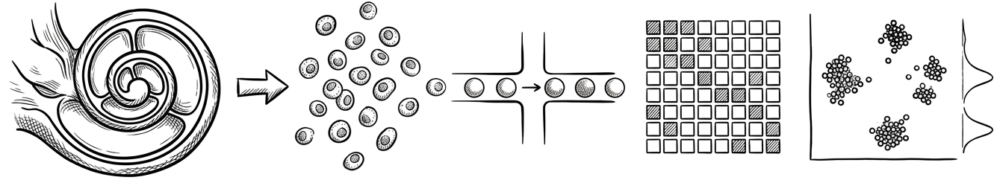

# Kushal Raj Roy

I am a **computational biologist** and a PhD student in the iBio program at the University of Iowa, where I study the cochlea using single-nucleus RNA-seq. I also founded **Genoproteomics**, a precision medicine venture that brings together multi-omics, structural biology, and AI.

I build analysis methods for single-cell and multi-omics data, and I contribute to open-source bioinformatics tools. Open science, reproducible research, and mentorship matter to me.

[LinkedIn](https://linkedin.com/in/kroy3) · [ORCID](https://orcid.org/0000-0002-4664-7462)

 

---

## Currently

- Developing a QC and analysis pipeline for **single-nucleus RNA-seq in cochlear immunology**, characterizing cell-type-specific transcriptional response and immune cell populations in the inner ear.

---

## Open-source contributions

| Merged pull requests | Upstream projects | Tools authored | Packages maintained |
|:---:|:---:|:---:|:---:|
| **2** | **2** | **1** | **2** |

| Project | Contribution |
|---|---|
| [galaxyproject/tools-iuc](https://github.com/galaxyproject/tools-iuc) | Author of the **scDblFinder** Galaxy tool for doublet detection in single-cell RNA-seq ([#8883](https://github.com/galaxyproject/tools-iuc/pull/8883)) |
| [IGS/gEAR](https://github.com/IGS/gEAR) | Added a **single-nucleus RNA-seq dataset type** to the gEAR gene expression portal ([#1363](https://github.com/IGS/gEAR/pull/1363)) |

---

## Software

| | |
|---|---|
| **[Decant](https://github.com/kroy3/Decant)** | R package for ambient RNA decontamination and contamination-aware differential expression in scRNA-seq and snRNA-seq. In development; results so far are on simulated data. |
| **[GeoShift](https://github.com/kroy3/GeoShift)** | Python package for cross-geometry pretraining of E(3)-equivariant graph neural networks. Code for the *AIP Advances* paper below. |

---

## Education

| | |
|---|---|
| **University of Iowa** | PhD in progress, Integrated Biology (iBio) |
| **University of Houston** | MSc, Biochemistry |
| **Savitribai Phule Pune University** | BSc, Microbiology |

---

## Publications

**Peer-reviewed journal articles**

- **Cross-Geometry Pretraining for Equivariant Neural Networks: Improving Molecular Property Prediction Under Computational Constraints.**
  *AIP Advances* 16(10), 105006, 2026. [10.1063/5.0317737](https://doi.org/10.1063/5.0317737) · [Code](https://github.com/kroy3/GeoShift)

- **Leveraging Agentic AI in Human-Computer Co-Creation: Cognitive Barriers, Trust Dynamics, and the Directive-Delegation Spectrum.**
  *Design and Artificial Intelligence*, 100100, 2026. Corresponding author.

- **Protein Function Prediction with Pretrained Transformers: Performance, Pitfalls, and Practical Guidance.**
  *Eurobiotech Journal*, 2026. [10.2478/ebtj-2026-0005](https://doi.org/10.2478/ebtj-2026-0005) · Scopus-indexed

- **miRNA-mRNA Multi-omics Integration in Breast Cancer Staging.**
  *Advances in Biomarker Sciences and Technology* 9(1), 70-82. [10.1016/j.abst.2026.06.003](https://doi.org/10.1016/j.abst.2026.06.003)

**Accepted / in press**

- **ReactionForge: A Temporal Graph Network for Suzuki-Miyaura Cross-Coupling Yield Prediction.**
  *International Journal of Complexity in Applied Science and Technology* (Inderscience), 2026.

- **Machine Learning-Guided Catalyst Selection Reveals Nickel's Advantages Over Palladium in Suzuki-Miyaura Cross-Coupling.**
  *International Journal of Complexity in Applied Science and Technology* (Inderscience), 2026.

Full record: [ORCID 0000-0002-4664-7462](https://orcid.org/0000-0002-4664-7462)

---

## Tools

| | |
|---|---|
| **Languages** | Python · R · Bash · SQL |
| **ML / Deep learning** | PyTorch · PyTorch Geometric · scikit-learn · HuggingFace Transformers |
| **Single-cell & genomics** | Seurat · Scanpy · edgeR · DESeq2 · STAR · Snakemake · Nextflow / nf-core · Galaxy (planemo) |
| **Omics & proteomics** | Waters UPLC-QDa · MassLynx · MaxQuant · STRING · Cytoscape |
| **Data science** | Pandas · NumPy · Matplotlib · Seaborn · Plotly · Jupyter |
| **Infrastructure** | Git · Docker · GitHub Actions · Conda · SLURM · AWS (S3/EC2) |
| **Structural biology** | PyMOL · AlphaFold2 |

---

## Outside the lab

Playing guitar, science documentaries, the history of molecular biology, and creative visual projects. Originally from Bangladesh, currently in Iowa City, IA.

---

